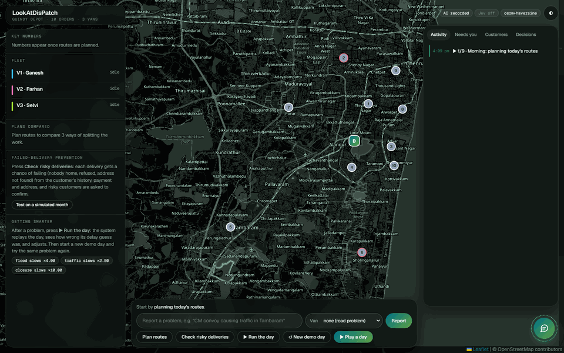
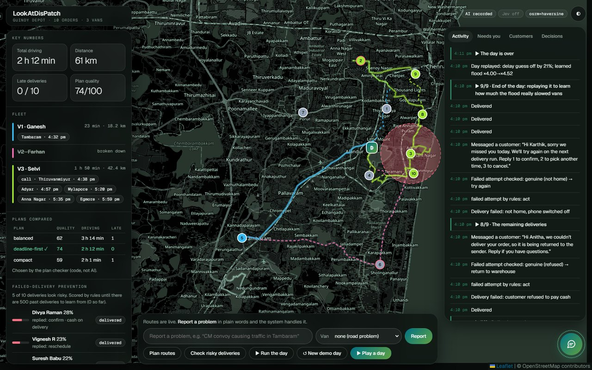
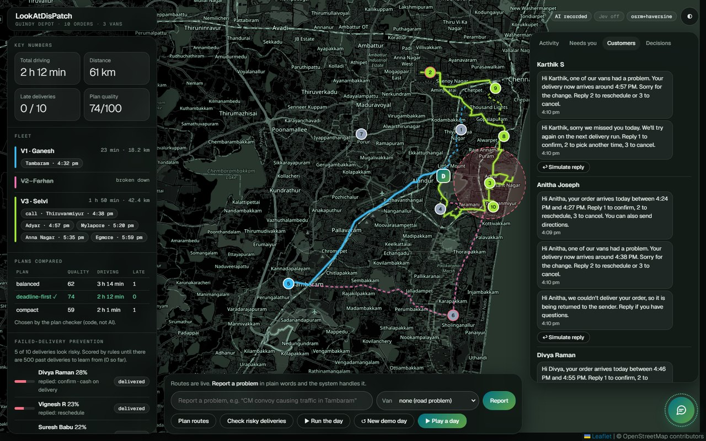
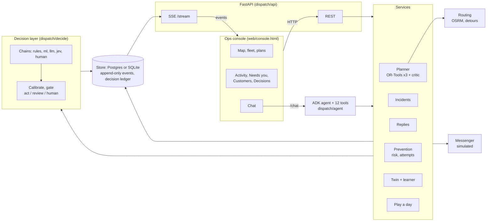
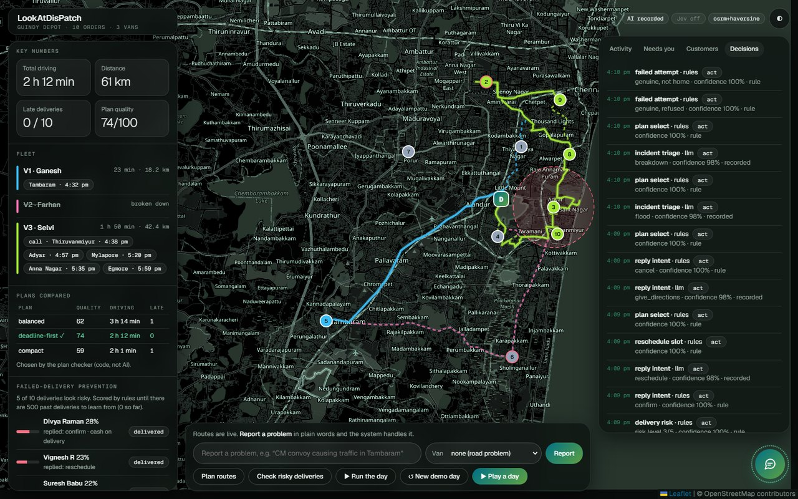

# LookAtDisPatch: Agentic last-mile delivery ops optimization

LookAtDisPatch is a dispatch system for a last-mile delivery fleet, built around a demo depot in
Chennai. It plans van routes on the real road network, accepts problem reports written in natural
language (for example "waterlogging at Velachery" or "V2 has a puncture"), re-plans around them,
notifies affected customers and processes their replies. It also estimates which deliveries are
likely to fail before dispatch, and replays each day in a simulator to improve its delay estimates.

Numeric work (routing, arrival times, plan scoring, risk scores) is done by an optimizer and
deterministic code. A language model is used only to interpret free text, and each of its answers
carries a calibrated confidence that decides whether the system acts on it or hands it to a person.



_The built-in demo ("Play a day"), which runs without an API key: route planning, a risk check,
customer replies, a flood in Adyar (previous routes dashed), a van breakdown, failed delivery
attempts, and the end-of-day replay._

## Features

- **Route planning** with Google OR-Tools on an OSRM road-distance matrix: time windows, van
  capacity and driver shifts. Three strategies (balanced, deadline-first, compact) are solved and
  scored, and the best plan is applied only if it improves on the current one.
- **Incident handling.** Free-text reports are classified (flood, traffic, closure, breakdown, other,
  or not an incident), located using a Chennai place gazetteer, and turned into a slowdown zone.
  Affected routes are re-planned and go around the zone when that is faster.
- **Customer messaging** (simulated). Customers whose arrival time changes are notified. Replies are
  classified as confirm, cancel, reschedule, directions or "leave with neighbour", and acted on.
  Requested times such as "after 6 pm" or "tomorrow morning" are parsed and applied.
- **Failed-delivery prevention.** Each order gets a probability of failure based on the customer's
  delivery history, cash on delivery, order value and address quality. High-risk customers are
  asked to confirm. Failed attempts are checked against the driver's GPS position and time at the
  door before the order is rescheduled or returned to the warehouse.
- **Confidence-gated decisions.** Every decision (rules, trained model, LLM or a person) is recorded
  in a ledger with its inputs, answer, confidence and outcome.
- **Simulation.** A digital twin replays the day with hidden "true" slowdowns. The planner's delay
  factors are adjusted from the difference.
- **Operations console** (map, fleet, plan comparison, activity feed, decision ledger) and a chat
  assistant that can answer questions and take actions through the same services.

**Stack:** Python 3.10+, FastAPI, SQLAlchemy (Postgres or SQLite), OR-Tools, OSRM, Google ADK with
Gemini, NumPy, Leaflet. Optional: TypeSafe Jev as an additional decision provider.

## Getting started

### Requirements

- Python 3.10 or newer.
- Optional: Docker Desktop, for Postgres and road routing with OSRM. Without Docker the app uses a
  local SQLite file and straight-line distances.
- Optional: a Gemini API key, for automatic triage of reports and replies, and for the chat
  assistant. Without a key, those items go to a manual review queue. The demo still runs, using
  recorded answers.

### Install

```powershell
# Windows (PowerShell)
py -3.11 -m venv .venv
.venv\Scripts\Activate.ps1
pip install -r requirements.txt
```

```bash
# macOS / Linux
python3 -m venv .venv && source .venv/bin/activate
pip install -r requirements.txt
```

To use real road distances, build the Chennai road network once. This requires Docker and downloads
about 550 MB:

```bash
python infra/prepare_osrm.py
```

### Run

```bash
python run.py            # use python3 on macOS / Linux
```

`run.py` re-launches itself inside `.venv` if needed, then:

1. starts the Docker services (Postgres, Redis, OSRM) if Docker is available,
2. loads the demo data (Guindy depot, 3 vans, 10 orders) into an empty database,
3. starts the API on http://127.0.0.1:8080 (OpenAPI docs at `/docs`),
4. serves the console on http://127.0.0.1:8001/console.html and opens it in the browser.

Stop it with Ctrl+C.

| Option        | Effect                                                                                     |
| ------------- | ------------------------------------------------------------------------------------------ |
| `--fresh`     | Reset the database and load a new demo day, discarding learned delay factors               |
| `--no-docker` | Use SQLite and straight-line routing even if Docker is installed                           |
| `--no-open`   | Do not open a browser tab                                                                  |

`API_PORT`, `UI_PORT` and `DATABASE_URL` can be set as environment variables.

### Configuration

Settings are read from `.env` in the repository root (see [.env.example](.env.example)); real
environment variables take precedence. If no Gemini key is set, the console shows a dialog that
validates a key and saves it to `.env`. Other settings include the model name (`GEMINI_MODEL`), the
optional TypeSafe key, the risk threshold for confirmation messages and the maximum number of
delivery attempts.

## Using the console

The quickest overview is **▶ Play a day** in the bottom bar. It resets the demo and runs a scripted
day in about a minute. Progress is shown in the **Activity** tab and the message history in
**Customers**.

To explore manually:

| Action | Result |
| ------ | ------ |
| **Plan routes** | Routes are drawn on the map. The fleet panel lists each van's stops and arrival times, and the three candidate plans are compared |
| **Check risky deliveries** | Each order is scored. In the demo data, five customers are above the threshold and receive a confirmation request. Until they reply, their stops are marked "call" for the driver |
| Report a problem, e.g. _"CM convoy causing heavy traffic in Tambaram"_ | The report is classified and placed on the map, and routes are re-planned. Reports the system cannot classify confidently (or all reports, without an API key) appear under **Needs you** |
| Select a van in the **Van** list, then report _"puncture, can't continue"_ | The van is taken off the road and its stops are reassigned |
| **↩ Simulate reply** in **Customers**, e.g. `3`, _"after 6 pm"_ or _"blue gate near the temple"_ | Cancels the order, reschedules it, or adds a note for the driver, respectively. Numeric replies and times are handled without the language model |
| **✗** next to an order in the prevention panel | Simulates a failed attempt. It is verified and then rescheduled, returned, or queued for review |
| **▶ Run the day** after an incident | Replays the day in the simulator and updates the delay factors. Repeating the same incident on new demo days reduces the prediction error (about 26% → 14% → 6%) |
| **Test on a simulated month** | Compares failure rates with no confirmations, confirmations for high-risk orders only, and confirmations for all orders |
| **Decisions** tab | Lists each decision with its source (rules, model, LLM or person), confidence and outcome |
| Chat button (bottom right) | Questions such as _"how's today going?"_ or _"any failed deliveries?"_, or a problem description. Requires a Gemini key with available quota |

| After a played day | Customer message threads |
| ------------------ | ------------------------ |
|  |  |

## How it works

### Architecture



All state changes are written as events to an append-only log. The console receives them over
Server-Sent Events. The chat agent's tools call the same service layer as the REST API, so both see
the same data.

### Planning and re-planning

The planner builds a travel-time matrix from OSRM and applies active incidents to it: the time of
each leg is multiplied in proportion to how much of the leg lies inside an incident zone. For each
zone, eight points on a ring just outside it are added as possible detour waypoints. A leg uses a
detour when that is at least 2% faster than driving through. OR-Tools solves the routing problem
with three cost profiles, and a scoring function compares the results against the current plan.

### Decisions

Each type of decision (incident triage, reply intent, reschedule time, delivery risk, failed-attempt
verification) has a list of providers that are tried in order, for example
`rules → llm → human`:

- **Rules** settle unambiguous cases at no cost: a reply of "1" or "yes", a parseable time, a driver
  who was within 150 m of the address for at least a minute.
- **The LLM** answers typed questions (a choice from a fixed list, a score, or yes/no). Probabilities
  come from token log-probabilities, or from repeated sampling if log-probabilities are not
  available, rather than from the model's own estimate of its confidence.
- **A trained model** (`ml`) is available for delivery risk and failed-attempt verification. It is
  used only once it has enough labelled outcomes and outperforms the rules on the most recent ones.
- **A person** receives anything that remains, through the **Needs you** queue.

Confidences are calibrated against recorded outcomes (isotonic regression once 200 outcomes exist)
and compared with per-decision thresholds. The result is to act, to act and flag the decision for
review, or to send it to a person. Decisions that cannot be undone, such as cancelling an order,
require higher confidence.

### Failed-delivery prevention

The risk score combines a prior based on the order (cash on delivery, order value, address quality,
whether it is a reattempt) with the customer's own delivery record (Beta-binomial smoothing). Orders
above the threshold get a confirmation message. Until the customer replies, their stop is not
scheduled earlier than the time given in the message. After a failed attempt, the driver's distance
from the address and the time spent there decide whether the attempt counts. A genuine failure
leads to a reattempt, or to a return after three attempts or a refused cash-on-delivery parcel.

### Learning from the simulated day

The twin replays the executed plan with a hidden "true" slowdown for each incident type. The learner
moves each delay factor halfway towards the observed value, limits each change to ±25%, and reverts
a factor if its error increases on two consecutive days.



## Results

These figures come from the demo data and the simulator, not from a real fleet.

| | Day 1 | Day 2 | Day 3 |
| --- | --- | --- | --- |
| Delay-prediction error after a flood | 25.8% | 13.9% | 6.1% |

| Failed deliveries over 30 simulated days (mean of 5 seeds) | No confirmations | High-risk only | All orders |
| --- | --- | --- | --- |
| Failure rate | ~17% | ~12% (28% fewer) | ~10% (41% fewer) |
| Orders messaged | 0% | 47% | 100% |

Customer behaviour after a confirmation message (reply rates, effect on failures) is an assumption
of the simulator, defined in `dispatch/twin/prevention.py`.

- Planning time on OSRM, including all three strategies (1 s search each): 3.6–4.5 s for 50 orders on
  5 vans, 4.4 s for 100 orders on 8 vans.
- A severe flood at Adyar reduced driving inside the zone from 11.3 km to 6.4 km, at a cost of 5.7 km
  of extra total distance.

## Project structure

```
run.py                 launcher: services, demo data, API (:8080), console (:8001), API key dialog
dispatch/
  core/                shared models, decision types, interfaces, events, configuration
  store/               SQLAlchemy store, event log, Alembic migrations
  routing/             OSRM and straight-line routing, incident slowdowns and detours
  optimize/            OR-Tools solver, plan scoring
  decide/              decision definitions, rules, trained model, LLM and Jev providers, calibration
  address/             Chennai place gazetteer
  messaging/           message templates, simulated messenger
  twin/                day simulator, learner, failed-delivery comparison
  agent/               chat assistant (Google ADK) and its tools
  api/                 FastAPI application (REST and SSE)
  planning.py          planning service
  incidents.py         incident triage and re-planning
  replies.py           customer reply handling
  prevention.py        risk scoring, confirmations, failed-attempt verification
  when.py              parsing of delivery times from text
  play.py, scenarios/  scripted demo day (python -m dispatch.play)
  eval.py, evals/      triage accuracy evaluation (python -m dispatch.eval)
  notify.py, demo.py   arrival-time notifications, demo data
web/console.html       operations console
docs/img/              README images
infra/                 Docker Compose services, OSRM data preparation
specs/                 design spec (v2-spec.md), roadmap, original hackathon spec
tests/                 test suite
```

The full design is documented in [specs/v2-spec.md](specs/v2-spec.md), and remaining work in
[specs/roadmap.md](specs/roadmap.md).

## Testing

```bash
pytest -q
```

The test suite runs offline and needs no API keys. Instructions for running the store tests against
Postgres are in [CLAUDE.md](CLAUDE.md).

Triage accuracy can be measured on 30 labelled incident reports in English, Tamil and Hindi:

```bash
python -m dispatch.eval
```

This needs a Gemini key and makes about 90 API calls. Answers are cached, so a run interrupted by
the free-tier quota resumes where it stopped.

## Troubleshooting

| Problem | Solution |
| ------- | -------- |
| Port 8080 or 8001 is already in use | Another instance is running. Stop it, or set `API_PORT` / `UI_PORT` |
| All reports end up in **Needs you** | No Gemini key is set, or the API is unavailable. The **Decisions** tab shows the error: `429 RESOURCE_EXHAUSTED` means the daily quota is used up, `503` means the model is overloaded. Set a different `GEMINI_MODEL` in `.env`, or use a key with billing enabled |
| Routing shows "straight-line estimate" | OSRM is not running. Run `python infra/prepare_osrm.py`, then restart |
| The console cannot reach the API | Start the app with `python run.py` instead of opening the HTML file directly |
| Missing packages | Activate the virtual environment and run `pip install -r requirements.txt` |

## Limitations

- OSRM uses free-flow speeds. Live traffic data is not used, and the 90th-percentile arrival times are
  a fixed margin rather than a model.
- The share of a leg inside an incident zone is estimated along the straight line between its
  endpoints, and detours are limited to eight waypoints per zone.
- Risk scoring and failed-attempt verification use hand-written rules until the trained model has
  enough data and outperforms them (`GET /ml/status` shows its state). In simulation this takes
  several months of deliveries.
- Customer messaging is simulated; no WhatsApp or SMS provider is connected.
- The Gemini free tier allows about 20 requests per day per model.

Started at Agent Wars - Google DevFest '26 Chennai (problem statement: Logistics Handler), and continued since.

Team Edita (1)

- [hotaru-py](https://github.com/hotaru-py)
- [Surya-nara0123](https://github.com/Surya-nara0123)
- [FrenzyVJN](https://github.com/FrenzyVJN)
