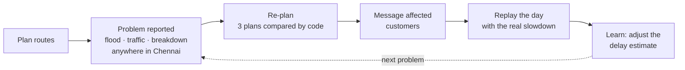
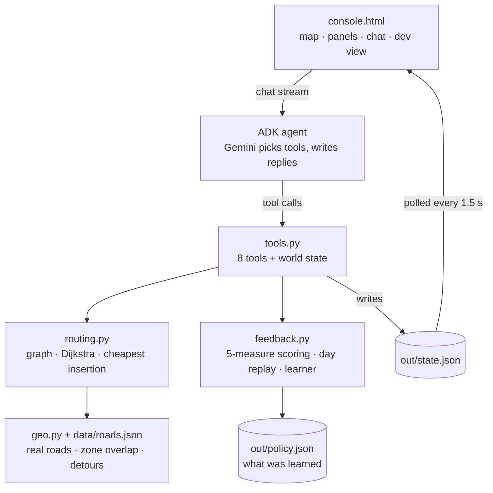

# Dispatch Agent: autonomous last-mile delivery for Chennai

An AI dispatcher, built on **Google ADK** and **Gemini**, that runs a small delivery
fleet: 1 warehouse in Guindy, 10 deliveries, 3 vans. It plans routes on real streets,
reacts when something goes wrong anywhere in the city, re-plans, messages affected
customers, and **learns from every day** so its next prediction is better. No human
approves any step.

> **To run it, see [RUN.md](RUN.md)** (`python run.py`; about 5 minutes from a fresh clone).

## The loop



1. **Plan.** The agent splits 10 deliveries across 3 vans three different ways (even
   workload, deadlines first, shortest driving). A scoring module written in plain code
   rates each on 5 measures (on time, efficiency, speed, balance, resilience) and applies
   the best.
2. **Sense.** You describe a problem in plain words: *"CM convoy causing traffic in
   Tambaram"*, *"waterlogging at Velachery"*, *"Van V1 broke down"*. It recognises
   about 40 Chennai areas and roads, including typos and aliases ("OMR", "GST Road").
3. **Decide.** It re-plans on the affected road network and compares the new plans
   with "do nothing". Roads through the zone are slowed only for the part inside it, and
   each leg picks the fastest real road, so vans **take genuine detours** on different
   streets.
4. **Act.** It writes each affected customer a short message with their new arrival time.
5. **Learn.** It replays the day with the *true* slowdown, which is hidden from it, and
   moves its estimate halfway toward what it observed. Bad updates roll back
   automatically.

## Results (offline runs on the seed data)

| | Run 1 | Run 2 | Run 3 |
|---|---|---|---|
| Flood slowdown the agent assumes (truth ≈ ×5) | ×4.0 | ×4.4 | ×4.7 |
| How far off its delay prediction was | 22% | 14% | 6% |

- A flood in Ashok Nagar: **84 minutes less driving** than keeping the old routes, with 2 road stretches swapped for detours.
- A van breakdown: late deliveries go from **4 to 0** after its stops are reassigned.
- Planning and re-planning take **under 0.2 s**. The slow part is only the Gemini call.

## Features

| | |
|---|---|
| **Real driving routes** | Street-level routes from OpenStreetMap (OSRM), cached in the repo, so routing works offline and needs no key |
| **Disruptions anywhere** | Floods, traffic (convoys, accidents, closures) and breakdowns, placed by area name or coordinates |
| **Code decides, AI explains** | Every number comes from deterministic code. Gemini picks which tool to call and writes the words, and it can't argue the scorer into a bad plan |
| **Self-improving** | The learned delay estimates persist between runs, with capped updates and automatic rollback |
| **Plain-English chat** | Written for non-technical users: clock times, "What I did" bullets, no jargon |
| **Developer view** | The `</>` button shows every model and tool call with raw inputs and outputs, token use, raw state, and the full scoring tables |
| **One-command start** | `python run.py` starts everything. If there's no key, the app asks for it, checks it with Google, and saves it locally |

## The console

| Area | Shows |
|---|---|
| Map | Real-street van routes, numbered delivery pins (urgent ringed red, affected ones pulsing), the problem zone, the old route dashed |
| Top bar | Progress through the 4 steps: plan, problem, re-plan & notify, learn |
| Left panel | Key numbers with before/after change, each van's stops and arrival times, the 3 plans compared, the "Getting smarter" chart |
| Right panel | What the agent did, step by step in plain words, and every customer message |
| Bottom dock | One-click Plan, Flood, Traffic, Breakdown and Reset |
| Chat (bottom right) | Talk to the dispatcher in your own words |
| `</>` Developer view | Trace, Tokens, State, Learning, Routing |

## How it works



- **Routing:** a sparse road graph (each stop linked to its 4 nearest) with Dijkstra
  shortest paths and cheapest-insertion multi-van routing, respecting van capacity and
  deadlines. Edge weights are real road distances at an assumed 25 km/h city van speed.
- **Disruptions:** a circle around the named place. Each road's slowdown is weighted by
  how much of it lies inside, and alternative roads (OSRM alternatives plus parallel
  detours) can win.
- **Learning:** only the in-zone part of each road is compared, predicted against real,
  so the measured slowdown is the true one. Each update is capped at ±25%, and the
  estimate rolls back if accuracy gets worse twice in a row.

## Project layout

```
run.py                      one-command launcher (agent API + console + key setup)
RUN.md                      quick start for judges
dispatch_agent/
  agent.py                  ADK agent: instruction, model (GEMINI_MODEL), retries
  tools.py                  the 8 tools the agent can call; writes out/state.json
  routing.py                graph, Dijkstra, multi-van solver
  feedback.py               scoring, day simulator, learner, policy store
  geo.py, places.py         road geometry and zone maths; Chennai place names
  data/roads.json           cached OpenStreetMap routes (55 stop pairs, up to 5 options each)
  console.html              the dashboard; map.html is an older verification board
scripts/fetch_roads.py      re-fetch road data from OSRM
tests/                      60 tests, no network or AI calls
specs/                      build spec, work split, shared context between team machines
logistics_agent/            earlier fallback demo (warehouse stock and transfers)
```

## Tests

```bash
pytest -q
```

## Limits

- Van speed is an assumption (25 km/h on real road distances), not live traffic.
- One problem at a time: reset between scenarios.
- On the free Gemini tier, each model allows about 20 requests a day, and one problem
  uses about 5. Switch `GEMINI_MODEL` in `dispatch_agent/.env`, or use a key with
  billing enabled.

Built for Google DevFest Agent Wars (problem statement: Logistics Handler).
