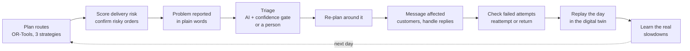

# Dispatch: last-mile delivery operations for Chennai

Dispatch runs a delivery fleet's day. It plans routes on real roads and reads problem reports
written in plain words ("waterlogging at Velachery", "V2 has a puncture"). It re-plans around those
problems, messages the customers affected and handles their replies. Before the vans leave, it
spots deliveries likely to fail and asks those customers to confirm. It also replays each day to
learn how much floods and traffic really slow the vans.

Code owns every number. Routes, arrival times, plan scores and risk scores come from a solver and
deterministic code. AI makes the judgement calls, such as what a report means, how severe it is and
what a customer's reply wants. Each judgement goes through a **confidence gate**: the system acts on
a confident answer, sends a less certain one to a person, and records every decision in a ledger.

The design is in [specs/v2-spec.md](specs/v2-spec.md).

## Quick start

You need **Python 3.10 or newer**. Both of these are optional:

- **Docker Desktop** gives you Postgres and real road routing (OSRM). Without it, Dispatch runs
  on a local SQLite file with straight-line distances.
- **A Gemini API key** lets problem reports and customer replies be handled automatically, and
  enables the chat. Without one, they wait for a person.

**1. Install (once)**

```powershell
# Windows (PowerShell)
py -3.11 -m venv .venv
.venv\Scripts\Activate.ps1
pip install -r requirements.txt
```

```bash
# macOS / Linux
python3 -m venv .venv && source .venv/bin/activate
pip install -r requirements.txt
```

For real roads, build the Chennai road network once. This needs Docker and downloads about 550 MB:

```bash
python infra/prepare_osrm.py
```

**2. Start**

```bash
python run.py              # python3 on macOS / Linux
```

`run.py` uses the project's `.venv` by itself and does the following:

1. Starts the Docker services if Docker is installed.
2. Loads the Chennai demo (Guindy depot, 3 vans, 10 orders) into an empty database.
3. Starts the API at http://127.0.0.1:8080 (interactive docs at `/docs`).
4. Opens the console at http://127.0.0.1:8001/console.html.

Stop with **Ctrl+C**.

| Option | Effect |
|---|---|
| `--fresh` | Wipe the database and load a fresh demo day, forgetting what was learned (the console's **↺ New demo day** keeps it) |
| `--no-docker` | SQLite and straight-line routing, even if Docker is installed |
| `--no-open` | Don't open a browser tab |

The environment variables `API_PORT`, `UI_PORT` and `DATABASE_URL` override the defaults.

**No Gemini key yet?** The console offers a **Connect Gemini** box. It checks the key with Google,
saves it to `.env` in the repo root and restarts the API. A key set as a system environment variable
also works. Other settings, including the optional TypeSafe Jev key and the risk threshold, are
listed in [.env.example](.env.example).

## Try it

| Do this | What you should see |
|---|---|
| Click **🗺️ Plan routes** | Coloured van routes on real streets, key numbers, each van's stops with arrival times, and the 3 plans compared |
| Click **🛡️ Check risky deliveries** | Each delivery gets a chance of failing, from the customer's history, cash on delivery and address quality. Five demo customers look risky and get a "please confirm" message. The **Failed-delivery prevention** panel lists them, and their stops show ☎ (the driver calls first) until they reply |
| In that list, click **✗** on a delivery and type what the driver said (*"not home"*, *"refused to pay"*) | The attempt is checked: was the driver at the address, and for long enough? *Not home* → another try, and the customer is messaged. A refused cash-on-delivery parcel goes back. Unclear attempts wait in **Needs you**. **✓** marks a delivery done |
| Click **🧪 Test on a simulated month** | Failed deliveries with no checks, with only risky customers asked, and with everyone asked |
| Type a problem, e.g. *"CM convoy causing heavy traffic in Tambaram"*, then **Report** | The AI works out what and where it is, a zone appears on the map, and the routes are re-planned. Without a key, or if the AI isn't sure, it waits in **Needs you** |
| Open **Needs you** | Each waiting report with the AI's suggestion. Pick the kind and severity, **📍 Pick location** on the map if needed, then **Activate** or **Not real**. **🤖 Ask AI again** retries the AI |
| Pick a van in the **no van** list and report *"puncture, can't continue"* | That van goes off the road and its stops move to the others |
| After a re-plan, open **Customers** | Each affected customer got a short message with their new arrival time |
| Click **↩ Simulate reply** on a message and type `3` | The order is cancelled, the customer is told and the routes are re-planned. Replies of 1/2/3 or yes/ok need no AI |
| Simulate a reply like *"blue gate near the temple"* or *"can you come tomorrow morning"* | Directions become a note for the driver. A new time is read from the reply ("after 6 pm", "4-6pm", "tomorrow morning"): the delivery moves, the customer is told, and the routes are re-planned. A vague one (*"some other time"*) waits in **Needs you**, where you can type the time. Telling directions from reschedules apart needs the AI (a key with quota) |
| After a problem, click **▶ Run the day** | The day is replayed against the "real" slowdowns. You see how far off the delay guess was, and the system adjusts. **↺ New demo day** keeps what it learned, so repeat the same problem and the error shrinks (about 26% → 14% → 6%) |
| Click **💬** (bottom right) and ask *"how's today going?"*, *"which deliveries might fail?"* or describe a problem | The dispatcher answers in plain words and acts, showing each step. Needs a Gemini key with quota |
| Open **Decisions** | Every decision: who made it (rules, AI or a person), how confident it was, and what happened |

## How it works



1. **Plan.** OR-Tools solves the vehicle-routing problem three ways (balanced, deadline-first and
   compact) on an OSRM road matrix. It respects time windows, van capacity and driver shifts. A
   critic scores each candidate and applies the best, or keeps the current routes if none is better.
2. **Prevent.** Every open delivery gets a chance of failing. The score starts from the order
   (cash on delivery, value, address quality, reattempt) and is updated with the customer's own
   delivery record. Risky customers are asked to confirm. An unconfirmed stop is planned no
   earlier than the time we told the customer, and the driver calls ahead. A customer who replies
   with a new time gets it. A model trained on past deliveries takes over from the scoring rules
   only once it ranks risky deliveries better than they do on recent outcomes.
3. **Sense.** Problems come in as free text from the console, the chat or the API.
4. **Decide.** Each judgement goes through a chain of decision providers: rules, then an LLM, then
   the optional TypeSafe Jev, then a person. The answers are typed: for a problem report, what kind
   it is, how severe, and whether it's credible. Probabilities come from token logprobs or from
   repeated sampling, never from the model's own stated confidence. Each answer is calibrated, then
   gated: *act*, *review* or *human*.
5. **Act.** The problem's area is slowed in the road matrix and the open stops are re-planned.
   Customers whose arrival time moves get a short message. Their replies (confirm, cancel,
   directions, reschedule) are triaged the same way.
6. **Check failures.** A failed attempt is checked against the driver's GPS distance from the
   address and their time at the door. A genuine failure means another try, or a return to the
   warehouse after 3 tries or a refused cash-on-delivery parcel. If the driver wasn't there, the
   attempt doesn't count against the customer.
7. **Learn.** The digital twin replays the day with hidden "true" slowdowns. The learner moves each
   delay factor halfway toward what it observed. Each update is capped at ±25%, and a factor rolls
   back if its error grows twice in a row.

## Measured (demo data and the digital twin)

| | Day 1 | Day 2 | Day 3 |
|---|---|---|---|
| Delay-prediction error after a flood | 25.8% | 13.9% | 6.1% |

| Failed deliveries over 30 simulated days (mean of 5 seeds) | No checks | Risky only | Ask everyone |
|---|---|---|---|
| Failure rate | ~17% | ~12% (**28% fewer**) | ~10% (41% fewer) |
| Customers messaged | 0% | 47% | 100% |

How customers behave after a confirmation message is a stated assumption in the twin
(`dispatch/twin/prevention.py`), not field data.

- With Postgres and OSRM, planning 10 orders on 3 vans takes about 3.5 s, all three strategies included.
- A flood report resolved from the human queue re-planned the routes and messaged 7 customers.

## Project layout

```
run.py                 launcher: services, demo data, API (:8080), console (:8001), Gemini key dialog
dispatch/
  core/                contracts: models, decisions, ports, events, config
  store/               SQLAlchemy store, append-only event log, Alembic migrations
  routing/             OSRM and straight-line engines, incident slowdowns
  optimize/            OR-Tools solver, plan scoring and critic
  decide/              decision catalogue, risk and attempt rules, providers (rules, trained model,
                       LLM, optional Jev), calibration, gates
  address/             Chennai place gazetteer (geocoding comes in phase 4)
  messaging/           message templates and the simulated messenger
  twin/                day simulator, learner, failed-delivery comparison
  agent/               ops chat: ADK agent and its tools
  api/                 FastAPI app (REST + SSE)
  planning.py          planner: matrix, 3 strategies, critic, apply
  incidents.py         problem triage and re-planning
  replies.py           customer reply handling
  prevention.py        risk check, confirmations, failed-attempt check, reattempt / return
  when.py              delivery times from customer text ("after 6 pm", "tomorrow morning")
  notify.py, demo.py   arrival-time messages; the Chennai demo day
web/console.html       the operations console
infra/                 Docker Compose services and OSRM data preparation
specs/                 v2 spec (current) and the original hackathon spec (history)
tests/                 offline test suite, including contract checks for every port
```

## Tests

```bash
pytest -q
```

The tests need no network access and no AI keys. To also run the store tests against Postgres, see
[CLAUDE.md](CLAUDE.md).

## If something goes wrong

| Problem | Fix |
|---|---|
| "Port 8080/8001 is already in use" | Another copy is running. Close it, or set `API_PORT` / `UI_PORT` |
| Reports always land in **Needs you** | There's no Gemini key, or the AI isn't reachable. The **Decisions** tab shows why: `429 RESOURCE_EXHAUSTED` means the daily free quota is used up, `503` means the model is overloaded. Try another `GEMINI_MODEL` in `.env`, or a key with billing |
| "Routing: straight-line estimate" | OSRM isn't running. Build its data with `python infra/prepare_osrm.py`, then restart |
| The console can't reach the API | Start everything with `python run.py`, not by opening the HTML file |
| "Missing packages" | Activate the venv and run `pip install -r requirements.txt` |

## Limits

- OSRM speeds are free-flow. Live traffic isn't used yet, and P90 arrival times are placeholders.
- A problem slows a straight-line share of each road leg. Real detours need OSRM segment-speed updates.
- Risk scores and failed-attempt checks use hand-set rules until a trained model has enough labelled
  outcomes and beats them on recent ones (`GET /ml/status` shows where it stands). On the simulator,
  that takes months of deliveries.
- On the free Gemini tier, each model allows about 20 requests a day. Set another `GEMINI_MODEL` in
  `.env`, or use a key with billing.

Started at Google DevFest Agent Wars (problem statement: Logistics Handler), and rewritten since as v2.
