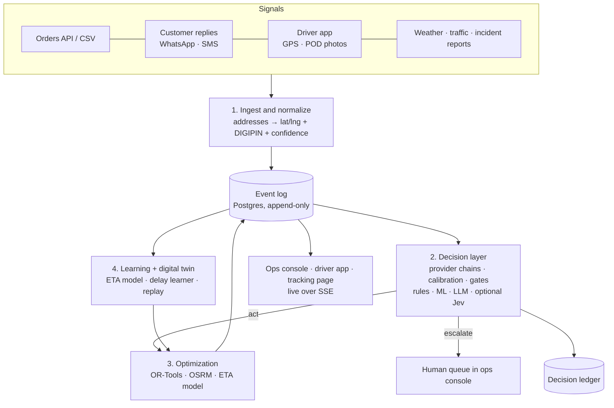

# Dispatch v2: Build Spec

Status: draft for review · 2026-10-17 · replaces [1230-spec.md](1230-spec.md) for all new work.

Dispatch v2 rebuilds the hackathon demo as a real last-mile dispatch system for a
small city fleet. The demo proved the loop (plan → disruption → re-plan → notify →
learn). v2 keeps that loop and adds the parts that decide whether deliveries actually
succeed in India:
- preventing failed deliveries,
- understanding Indian addresses,
- honest arrival times,
- real disruption signals,
- an audit trail of every decision, made by rules, trained models, an LLM or (optionally)
  a dedicated judgment model such as Jev, under explicit
  confidence gates.

How to use this spec: read sections 1–4 for the why and the shape, and section 6
before writing code. When code needs to differ from the spec, update the spec in the same
change. Don't let them drift apart.

---

## 1. Product

**Who it's for:** an operations team running one depot, 10–50 vans or bikes, and 200–2,000
deliveries a day in one city (Chennai first). The design leaves room for multiple depots
and cities later (phase 7), but nothing in phases 1–6 depends on them.

**Users**

| User | Surface | Needs |
|---|---|---|
| Dispatcher / ops lead | Ops console (web) | Today's plan, live exceptions, what the system did and why, override anything |
| Driver | Driver app (installable web app) | Ordered stops, navigation hand-off, mark delivered or failed with proof, report problems |
| Customer | Tracking page + WhatsApp/SMS | Honest arrival window, reschedule, give directions, share location |
| Engineer | Decision ledger, developer view | Why each decision happened, who made it, how confident, what it cost |

**Goals**
- Fewer failed deliveries and returns to origin, caught *before* the van leaves.
- Arrival windows customers can trust (a P50/P90 range, not a single time).
- An autonomous operation that knows when *not* to act alone.
- Every decision explainable and replayable.

**Non-goals (v2)**
- Payments, invoicing, warehouse slotting and inventory, long-haul or line-haul.
- Real money movement for cash on delivery. Cash on delivery is modelled only as order
  attributes and risk.
- Native mobile apps. The driver app is an installable web app.

---

## 2. Selling points and how we measure them

| # | Selling point | Metric | Target (phase where it's measured) |
|---|---|---|---|
| U1 | **Confidence-gated autonomy.** Each decision has an owner (rules, a trained model, an LLM, an optional judgment model such as Jev, or a human) and a calibrated confidence. The system acts alone only above its gate | Automation rate = decisions completed without a human / all decisions; wrong-auto-action rate | Ledger reports both (P2) |
| U2 | **Failed-delivery prevention.** Risk-score orders before dispatch, confirm high-risk ones, re-plan around the answers | Failed-delivery rate on the digital twin, policy vs no-policy | 25% fewer simulated failures (P3) |
| U3 | **Indian address intelligence.** Landmark text → coordinates + DIGIPIN, with a confidence, and the customer is asked only when unsure | Share of addresses resolved automatically; median geocode error on a labelled set | ≥85% automatic; error <150 m (P4) |
| U4 | **Honest arrival times.** Probability ranges per stop, learned per zone, hour and disruption | Share of deliveries inside the promised window; P50 absolute error | ≥85% inside window (P5) |
| U5 | **Real disruption sensing.** Weather, traffic and incident reports triaged into typed incidents. Several can be active at once | Triage accuracy on a labelled incident set; time from report to re-plan | ≥90% kind accuracy; <10 s (P2) |
| U6 | **Digital twin.** Replay any past or synthetic day under any policy before it goes live | Every policy change ships with a replay report | Required from P5 |

Targets are starting points. Each phase's acceptance criteria (section 13) say how to
measure them, mostly on the simulator, because we have no production traffic yet.

---

## 3. Architecture



### 3.1 The ownership rule (non-negotiable)

| Kind of work | Owner | Never |
|---|---|---|
| Numbers: distances, times, costs, scores, assignments | **Deterministic code** (optimizer, ETA model, scorer) | An LLM or judgment model producing or editing a number that lands in a plan |
| Typed judgments: classify, score, verify, route | **A `Decider` provider chain per decision type** (section 7): rules, trained ML, the LLM, or an optional judgment model such as Jev | Free-text output; uncalibrated confidences reaching a gate |
| Language and open-ended reasoning: explanations, messages, ops chat | **Gemini** (ADK agent) | Deciding anything the gates said needs a human |
| Anything below its gate | **Human** in the ops console | Silent auto-action |

### 3.2 Components

| Component | Tech | Notes |
|---|---|---|
| API + workers | Python 3.11, FastAPI, Pydantic v2, background worker (arq on Redis, or the database as a queue in phase 1) | One codebase, two process types |
| Store | Postgres 16 + PostGIS | Domain tables + append-only `events` + `decisions` |
| Road network | Self-hosted **OSRM** (Docker) on the Geofabrik India **Southern Zone** extract (532 MB; check that it covers Tamil Nadu) | `/table` for matrices (requested in blocks for large fleets), `/route` for shapes. Fallback when OSRM is down: straight line × 1.3 at 25 km/h (`FallbackEngine`). OSRM times are free-flow car times; `OSRM_TIME_FACTOR` scales them until the ETA model learns real factors |
| Solver | **Google OR-Tools** routing | Time windows, capacity (weight + volume), pickup-and-delivery, driver breaks, live insertion |
| Decisions | `Decider` providers: `rules`, `ml` (scikit-learn / LightGBM, calibrated), `llm` (Gemini, schema-constrained), **optional** `jev` (`typesafe-sdk`, `POST https://api.typesafe.ai/v1/systemone`) | Chosen per decision type by config; works with no optional provider configured |
| Agent | Google ADK + Gemini (`GEMINI_MODEL`) | Ops chat, explanations, message drafting, escalation reasoning |
| Front end | **As built:** one plain HTML + Leaflet page, `web/console.html`, on `/state` + the SSE stream, started by `run.py`. React + Vite + TypeScript once the console outgrows a single file | Ops console first; driver app and tracking page in phase 6 |
| Messaging, weather, traffic | Interfaces with **simulated** implementations first | Real providers plug in later (section 6) |

---

## 4. Repository layout

As built; folders marked *(planned)* are empty placeholders for later phases.

```
run.py                       # launcher: Docker services, demo data, API (:8080), console (:8001), key dialog
dispatch/
  api/                       # FastAPI app (REST + SSE stream + /chat)
  core/                      # contracts: models, decisions, ports, events, config, ids
  store/                     # SQLAlchemy store (Postgres or SQLite), event log, ledger, Alembic migrations
  routing/                   # engines.py (OSRM, haversine, fallback), incidents.py (slowdowns in the matrix)
  optimize/                  # OR-Tools solver, plan scoring + critic, retiming
  decide/                    # engine (chains, gates, shadow), calibrate, catalogue, risk.py (risk and
                             #   failed-attempt rules), ml.py (trained provider), deciders/{rules,llm}.py,
                             #   deciders/optional/jev.py
  address/                   # places.py (Chennai gazetteer); parser, geocoders, DIGIPIN in phase 4
  eta/                       # (planned, phase 5) quantile ETA model
  signals/                   # (planned) weather / traffic sources
  messaging/                 # templates, SimMessenger; WhatsApp / SMS in phase 7
  twin/                      # day replay (simulate, day), learner, prevention comparison
  agent/                     # ADK ops chat; tools call the services, never the DB
  planning.py, incidents.py, replies.py, prevention.py, notify.py, demo.py   # services
  when.py                    # delivery times from customer text (reschedule replies)
web/                         # console.html (plain HTML + Leaflet); driver + tracking in phase 6
infra/                       # docker-compose.yml (postgres, redis, osrm), prepare_osrm.py
tests/                       # pytest, offline; contracts/checks.py checks every port implementation
```

The v1 demo (`dispatch_agent/`, `logistics_agent/`) was removed once v2 reached parity.

---

## 5. Data model

All ids are prefixed strings (`ord_…`, `veh_…`). All times are UTC timestamps; display
uses the depot's time zone. Coordinates are `(lat, lng)`.

**Storage (as built, `dispatch/store/`).** Each table keeps the full Pydantic model as a JSON
document (`doc`, JSONB on Postgres) plus indexed columns for what we query; the models in
`dispatch/core/` stay the single source of truth. Coordinates are plain `lat`/`lng` columns so
the same schema runs on SQLite (dev/tests) and Postgres. PostGIS `geography` columns get added
by migration when spatial queries need them. Plans are immutable: a plan's routes and stops live
inside its document, and `current_plans` points each depot at its applied plan. The database
enforces two rules with triggers: `events` is append-only, and `decisions` rows are immutable
except `outcome`, which can be set once. Every change and its event commit in one transaction.
Schema changes go through Alembic (`alembic -c dispatch/store/alembic.ini upgrade head`).

| Table | Key fields |
|---|---|
| `depots` | id, name, location, opens_at, closes_at |
| `vehicles` | id, depot_id, kind (`van`/`bike`/`ev3w`), capacity_kg, capacity_l, range_km (null if not EV), status |
| `drivers` | id, name, phone, shift_start, shift_end, break_rules |
| `orders` | id, customer_id, kind (`delivery`/`pickup`), raw_address, location, digipin, geo_confidence, window_start, window_end, weight_kg, volume_l, payment (`prepaid`/`cod`), cod_amount, priority, state |
| `customers` | id, name, phone, language, history (counts of delivered / failed / refused) |
| `plans` | id, created_at, reason, params, scores (kpis), parent_plan_id |
| `current_plans` | depot_id, plan_id (stops live inside the plan document: order_id, seq, eta_p50, eta_p90, planned_arrival) |
| `incidents` | id, kind (`flood`/`traffic`/`closure`/`breakdown`/`other`), geometry (polygon or circle), severity, source, starts_at, ends_at, state |
| `events` | seq (bigserial), ts, type, entity, payload jsonb. **Append-only** |
| `decisions` | see 6.3 |
| `policies` | version, params jsonb (delay factors, gate thresholds, solver weights, history of simulated days), created_by, parent_version |

`order.state`: `new → geocoded → confirmed? → planned → out_for_delivery → delivered | failed → (reattempt | rto)`.
As in v1, no record uses a bare `status` key for its own state.

---

## 6. Contracts (all modules code against these)

Python `Protocol`s live in `dispatch/core/ports.py`. Every implementation must pass the
shared contract tests in `tests/contracts/`.

### 6.1 Ports

```python
class RoutingEngine(Protocol):
    def matrix(self, points: list[LatLng], depart_at: datetime | None = None) -> Matrix: ...   # seconds + meters
    def route(self, points: list[LatLng]) -> RouteShape: ...                                   # geometry + legs

class Solver(Protocol):
    def solve(self, problem: VrpProblem, time_limit_s: float = 5) -> Plan: ...
    def insert(self, plan: Plan, orders: list[Order], problem: VrpProblem) -> Plan: ...        # live insertion, keeps sequence for stops already passed

class Decider(Protocol):
    name: str                                                                                  # "rules" | "ml" | "llm" | "jev" | any plug-in
    capabilities: set[str]                                                                     # e.g. {"text", "tabular", "image"}
    async def decide(self, state: dict, questions: dict[str, Question]) -> dict[str, Answer]: ...

class Geocoder(Protocol):
    async def geocode(self, raw: str, hint: LatLng | None = None) -> GeoResult: ...            # lat/lng, digipin, confidence, method

class EtaModel(Protocol):
    def predict(self, legs: list[Leg], context: EtaContext) -> list[EtaQuantiles]: ...        # p50, p90 per stop

class Messenger(Protocol):
    async def send(self, to: Customer, template: str, vars: dict, channel: str) -> MessageRef: ...

class SignalSource(Protocol):
    async def poll(self, since: datetime) -> list[RawSignal]: ...
```

`Question` and `Answer` are three typed primitives, so every provider is interchangeable.
They match Jev's API shapes, which makes Jev a drop-in provider, but nothing requires it:
- `Choice{criteria: dict[label, description]}` → `{choice, probabilities, confidence}`
- `Score{levels: list[str]}` → `{score, probabilities, confidence}`
- `Noul{}` → `{p}`, with `confidence = |2p − 1|`.

Every provider returns probability distributions; section 7.2 says how each one gets them.

### 6.2 Gates

```python
@dataclass
class Gate:
    act: float = 0.90       # >= act: execute automatically
    review: float = 0.50    # [review, act): execute only if reversible, else try the next provider in the chain; flag in console
                            # < review: human queue
```

Gates read the **calibrated** confidence (section 7.3), never a provider's raw number.
Starting values are conservative: a 0.5 floor and ≥0.9 to act alone, and ≥0.95 for a
(decision type, provider) pair with fewer than 200 labelled outcomes. Thresholds live in
`policies` per decision type, and phase 5 tunes them on the twin.

### 6.3 Decision ledger record

```json
{ "id": "dec_…", "ts": "…", "type": "incident_triage", "subject": "inc_…",
  "decider": "llm", "model": "gemini-3.6-flash", "method": "logprobs", "questions": {…}, "answers": {…},
  "raw_confidence": 0.97, "confidence": 0.91, "shadow": [{"decider": "jev", "answers": {…}, "confidence": 0.93}], "gate": {"act": 0.9, "review": 0.5}, "route": "act|review|escalated|human",
  "action": {"kind": "replan", "ref": "plan_…"}, "latency_ms": 148, "cost": {"input_tokens": 428, "output_tokens": 73},
  "outcome": null, "outcome_at": null }
```

`outcome` is filled in later by the learner (for example "customer was home", "incident was
real"), which makes calibration and the automation metrics computable.

### 6.4 Events (first set)

`order.created`, `order.geocoded`, `order.confirmed`, `order.noted`, `plan.created`, `plan.applied`,
`stop.arrived`, `stop.delivered`, `stop.failed`, `incident.reported`, `incident.triaged`,
`incident.closed`, `message.sent`, `message.received`, `decision.made`,
`decision.overridden`, `policy.updated`, `vehicle.gps`, `day.simulated`. The payload schemas are Pydantic
models in `dispatch/core/events.py`.

---

## 7. Decisions

### 7.1 Catalogue

Each decision type has a **provider chain**: try providers in order, move on when one is
unavailable or its calibrated confidence lands below `review` for an irreversible action,
and end at the human queue. The defaults below need no optional provider. "Optional"
lists providers that can be added to a chain by config (`DECIDERS`, section 15).

| Decision | Trigger | Questions | Action on `act` | Default chain | Why that default | Optional |
|---|---|---|---|---|---|---|
| **Incident triage** | `incident.reported` (text, place, source) | kind: Choice(flood, traffic, closure, breakdown, other, not_an_incident); severity: Score(low…high); credible: Noul | create incident, re-plan | `llm → human` | Free text in English, Tamil or Hindi: a language task | `jev` first, `llm` as fallback |
| **Reply intent** | `message.received` | intent: Choice(confirm, reschedule, cancel, deliver_to_neighbour, give_directions, other); has_time: Noul | update window / state, re-plan | `rules → llm → human` | Rules catch "yes", "1", "cancel" and button replies for free; the LLM handles the rest | `jev` before `llm` |
| **Delivery risk** | before dispatch, per order | will_fail: Score(5 levels); refuse_risk_cod: Noul | confirm via WhatsApp if risky | `ml → rules` | Tabular data (history, payment, address confidence, area, time): a trained, calibrated classifier beats any language model here. Rules until 500 labelled outcomes exist | `llm` or `jev` only to read free-text order notes into a feature |
| **Address parse check** | `order.created` | which_candidate: Choice(candidates…, none); landmark_based: Noul | accept geocode | `rules → llm → human` | String similarity + geocoder score settle most cases; the LLM reads landmark-style addresses | `jev` before `llm` |
| **Failed-attempt verify** | `stop.failed` | genuine: Noul; reason: Choice(not_home, refused, wrong_address, unsafe, other) | schedule reattempt | `rules → ml → human` | GPS distance and time at the door are numbers: geofence rules, then a model trained on outcomes. The driver's reason text goes to the `llm` only when it decides the reason | `jev` for the reason text |
| **POD photo check** (phase 6, off by default) | `stop.delivered` with photo | parcel_visible: Noul; doorstep_like: Noul | accept | `off` (sample for human review) | Vision models need validation on our photos first | `llm` (Gemini vision) or `jev` (images, when TypeSafe marks them production-ready) |

Batch every question for one subject into **one** provider call (one prompt for the LLM, one
request for Jev). Jev's docs report batching is about 10× faster and 12× cheaper, and one LLM
call instead of three matters on Gemini's free tier.

**Incident triage (as built, `dispatch/incidents.py`).** One call asks all three questions
(kind with a `not_an_incident` option, severity on five concrete levels, credible). Not credible
or `not_an_incident` → rejected. Breakdowns take the named vehicle off the road (none named →
human queue). Road incidents are placed from the report text with the Chennai gazetteer
(`dispatch/address/places.py`, radius by kind: flood 3 km, traffic 2 km, closure 800 m); no
place found → human queue. Slowdown = 1 + (policy delay factor − 1) × (0.25 + severity), so the
learned policy drives predictions. Then every depot with a plan is re-planned. Humans resolve
queued incidents or override with `POST /incidents/{id}/resolve`, logged as `decider: human`.

**Customer replies (as built, `dispatch/replies.py`).** Our messages end with "Reply 1 to confirm, 2 to
reschedule, 3 to cancel", so the `rules` provider settles 1/2/3 and plain yes/ok without AI; the LLM
reads everything else. Confirm → order confirmed; cancel → cancelled, customer told, depot re-planned;
directions or "leave with neighbour" → appended to the order notes for the driver (`order.noted`);
reschedule → a `reschedule_slot` decision (below); other → a person. Reply decisions are not
reversible, so a medium-confidence answer escalates instead of acting.

**Reschedule time (as built, `dispatch/when.py`).** Decision `reschedule_slot`, chain `rules → llm → human`,
one Choice question over six slots (today/tomorrow × morning, afternoon, evening) plus `unclear`. The
`rules` provider is a deterministic parser for clock times and day words ("after 6 pm", "4-6pm",
"tomorrow morning", "friday evening", Tamil "naalai"); hours without am/pm read as people write them
(1–7 → PM). When it parses, the exact window is used (not just the slot); otherwise the LLM's slot
window is. A time that has (nearly) passed today means tomorrow. The order's window is replaced
(`order.rescheduled`), the customer gets a `rescheduled` message, and the depot re-plans; a window that
starts after the depot closes takes the order out of today's plan. `unclear` → a person, who can type
the time (`POST /messages/{id}/resolve` with `when`, parsed by the same code).

**ETA updates (as built, `dispatch/notify.py`).** After an incident re-plan is applied, every customer
whose arrival moved by more than 10 minutes or whose van changed gets a code-template message (plain
reason such as "there's flooding near Sholinganallur" + the new clock time, under 40 words). Messages
go through the `Messenger` port; `SimMessenger` records them as events until a real provider (phase 7).

**Delivery risk (as built, `dispatch/decide/risk.py`, `dispatch/prevention.py`).** The `rules` provider is a
Beta-binomial estimate: a prior from the order (COD, high-value COD ≥ ₹2,000, geocode doubt, reattempt,
first order) updated by the customer's own delivered/failed/refused record as if the prior were 3 past
orders. P(fail) is reported as a 5-level Score whose expected level value equals the estimate, so `ml`,
`llm` or `jev` can replace it without changing callers. `gating` is empty (the action, a confirmation
message, is cheap), so the score always acts. Risky = P(fail) ≥ `RISK_CONFIRM_THRESHOLD` (default 0.1) or
P(refuses COD) ≥ 0.3. Customer history is updated by the store: `stop.delivered` adds a delivery, a
*genuine* failed attempt adds a failure (and a refusal).

**Failed-attempt verify (as built).** Runs inside `POST /driver/stops/{id}/fail`. Rules: driver more than
400 m from the address → not genuine; within 150 m and at least 60 s at the door (`dwell_s` from the driver
app, else measured from `/arrive`) → genuine; anything else goes down the chain (`ml` isn't built yet) to a
person (`/queue` kind `attempt`, resolved with `POST /orders/{id}/attempt/resolve`). The reason comes from
keywords in the driver's text. Genuine → reattempt with a `reattempt_offer` message, or RTO (`returning`
message) after `MAX_ATTEMPTS` genuine failures (default 3) or at once for a refused COD parcel. Not genuine →
`disputed`: reattempt, not counted against the customer or the RTO limit, with a note for ops.

### 7.2 Providers

| Provider | How it produces probabilities | Cost and latency | When to use |
|---|---|---|---|
| `rules` | Fires or doesn't: confidence 1.0 when a rule fires, else the chain moves on | Free, microseconds | Unambiguous cases: exact keywords, geofences, button replies |
| `ml` | A scikit-learn or LightGBM classifier trained on ledger outcomes, with calibrated probabilities (isotonic or Platt scaling). **As built (`dispatch/decide/ml.py`):** L2 logistic regression (numpy, IRLS, sample weights), trained per decision type from the ledger's recorded `inputs` joined with outcomes; live only after the minimum labels **and** a check on the newest 20% (delivery risk: AUC must beat the rules' by 0.01; failed attempt: AUC ≥ 0.7); retrained every 5 minutes; `GET /ml/status` | Free, milliseconds | Tabular or numeric inputs, once there are enough labelled outcomes |
| `llm` | Gemini with a constrained output schema (enum or JSON). **Probabilities from token logprobs** where the model and endpoint support them (checked once at startup), **otherwise self-consistency**: k samples (default 5, temperature 0.7) give an empirical distribution. Never the model's own stated confidence | One call (logprobs) or k calls (sampling); ~0.5–3 s | Language understanding with no labelled data yet |
| `jev` (optional) | Native typed answers with probabilities | ~150 ms per Jev's docs; pricing not published | Any text judgment, when `TYPESAFE_API_KEY` is set and it wins in shadow mode |
| plug-in | Any class implementing `Decider` and passing `check_decider` | — | Another judgment model, a fine-tuned local classifier, etc. |

### 7.3 Calibration and shadow mode

- **Calibration:** raw confidences differ between providers and aren't correctness
  (an LLM's or Jev's 0.9 is not "right 90% of the time"). For each (decision type,
  provider) pair, a calibrator fitted on ledger outcomes maps raw → calibrated confidence.
  The ledger stores both, and gates read only the calibrated one. Until 200 outcomes exist,
  the identity map is used with the stricter 0.95 act threshold (section 6.2).
- **Shadow mode:** a provider listed under `DECIDERS_SHADOW` runs on the same input
  alongside the live chain. Its answers are logged in the ledger but never acted on. A
  weekly report compares accuracy, calibration error, latency and cost per decision type.
  Promoting a provider into a live chain is a policy change and needs a replay report
  (section 9).

---

## 8. Optimization

- **Model:** a capacitated routing problem with time windows over the OSRM matrix, plus:
  - pickups and deliveries,
  - per-driver shift windows and breaks,
  - weight and volume dimensions,
  - EV range as a distance dimension capped by `range_km` (charging stops in phase 7),
  - soft windows with a lateness penalty (×3 for priority orders, as in v1), so a solution always exists.
- **Disruptions:** an incident's geometry slows the matrix arcs whose road shape crosses it,
  weighted by the share of the road inside (v1's `zone_fraction`). Several incidents combine
  by multiplying their slowdowns per arc.
- **Incidents in the matrix (as built):** each arc's share inside an incident area is estimated
  on the straight segment between its ends (sampled every 200 m), because fetching a road shape
  per pair is too slow. The solver then reorders stops around slowed arcs, but OSRM's drawn road
  can still cross the area. **Next routing upgrade:** push incident slowdowns into OSRM itself
  with MLD live speed updates (`osrm-customize --segment-speed-file`), so routes genuinely detour
  (v1 achieved this with cached alternative roads).
- **Live insertion:** `Solver.insert` fixes each van's stops already visited and its current
  position, then re-optimizes the remainder within a time limit (default 2 s).
- **Plan scoring:** v1's five-measure critic (on time, efficiency, cycle, balance, resilience)
  moves to `optimize/score.py`, and the three-candidate comparison stays. A plan applies only
  if it beats keeping the current plan.

---

## 9. Learning and the digital twin

- **ETA model:**
  - Baseline is the OSRM time × learned factors per (zone, hour-of-week, incident kind),
    i.e. v1's delay learner, generalized.
  - Phase 5 adds quantile regression (LightGBM, P50/P90) trained on `stop.arrived` events.
  - It follows DoorDash's split: the model predicts a range, and a separate promise policy
    picks the time shown to the customer.
- **Calibration:** a nightly job joins `decisions` with their `outcome`s, plots
  reliability per decision type, and proposes new gate thresholds. Applying them is a
  `policy.updated` event.
- **As built (`dispatch/twin/`, `POST /day/run`, console "▶ Run the day"):** the twin replays the current plan
  with hidden true factors per incident kind (flood ×5, traffic ×3, closure ×12, other ×1.8; ±3% seeded noise),
  scaled by severity exactly like predictions. Base, predicted and actual timelines all come from the routing
  engine's matrix. The learner moves each kind's factor halfway to the observed one (±25% cap), rolls back
  after two rising errors, and saves a new policy version with a `history` entry; a `day.simulated` event
  holds the report. Demo resets keep learned policies (`run.py --fresh` forgets them). Measured: delay error
  25.8% → 13.9% → 6.1% over three flood days on real roads.
- **Digital twin (`twin/`):**
  - A scenario generator produces orders, customer behaviour (home or not, reply probabilities by
    risk), incidents with hidden true severity, and driver noise.
  - `replay(day, policy) → report` with every section 2 metric.
  - v1's `simulate_day` is the seed. Every policy or threshold change needs a replay report
    in its PR.

---

## 10. Failed-delivery prevention flow

1. When orders are cut off for the day, score delivery risk (section 7) for every order.
2. Above the risk threshold, send a confirmation over WhatsApp, or SMS as a fallback:
   arrival window, a link to share location or DIGIPIN, and reschedule options.
3. Replies go through reply-intent triage:
   - **Confirm:** keep the order.
   - **Reschedule:** move its window or day.
   - **Directions:** append them to the stop notes and re-geocode if a location was shared.
   - **Cancel:** drop the order before dispatch.
4. Plan or re-plan with the updated windows. Orders with no reply go late in the route,
   with a call reminder to the driver.
5. On `stop.failed`: run failed-attempt verify. If genuine, offer a reattempt slot to the
   customer. After the configured number of attempts, mark it for return to origin (RTO).

**As built (phase 3).** `POST /prevention/run` (console **🛡️ Check risky deliveries**, chat tool
`check_risky_deliveries`) plans first if there is no plan, scores every open order, and sends
`confirm_request` with the planned arrival time to risky customers not yet asked (`order.risk_scored`,
`order.confirm_requested`). Replies set `Order.customer_reply` (`order.replied`). Step 4 differs from
the text above: instead of "late in the route", an unconfirmed risky order is planned **no earlier than
the time we told the customer** (`VrpProblem.not_before`, a soft lower bound costing as much per second as
lateness), and its stop is marked `call_first` for the driver. Vans now leave at the plan start and waiting
costs `wait_penalty` per second, so the solver reorders stops rather than idling. Reschedule replies
pick their new time automatically (section 7.1, "Reschedule time").

**Measured on the twin (`dispatch/twin/prevention.py`, `GET /twin/prevention`).** 300 synthetic customers
with hidden habits (15% often away, 10% refuse COD, 25% hard-to-find addresses), 60 orders a day for 30 days.
The same days run under three policies with common random numbers. What a confirmation changes is a stated
assumption (`ASSUMPTIONS`: 65% reply; a reply removes part of the away / address risk; 60% of would-be
refusers cancel instead; no reply → driver call removes 20%). Over seeds 1–5 at the default threshold:

| Policy | Failed deliveries | Fewer than none | Orders messaged |
|---|---|---|---|
| None | ~17% | – | 0% |
| Risky only (Dispatch) | ~12% | **28% (min 25%)** | 47% |
| Everyone | ~10% | 41% | 100% |

At a 25–30% message budget, the risk score gets about 19%, against 24% for an oracle that knows each
customer's true habits, so the 25% target needs the lower threshold rather than a better score.
Real reply data should replace the assumptions before any claim leaves the simulator.

**The trained risk model on the twin.** The report's `learned` policy runs the rules for `train_days`,
then puts the `ml` provider's training through the production check (section 7.2). It learns from
unmessaged orders plus a 10% exploration holdout (risky orders deliberately not messaged, weighted ×10),
because a confirmation changes the outcome and biases a messaged order's label. While building it,
training on all outcomes as-is ranked failures worse than the rules (AUC ~0.66 vs ~0.70), and training
on unmessaged orders without a holdout was worse still (it never sees risky customers). Results, seeds 1–5:
- After 10 days (~350 usable labels) the model ranks worse than the rules (AUC 0.48–0.66 vs 0.67–0.74 on
  later days), and it can't take over anyway: it needs 500 labels.
- After 60 days (~2,000 labels) it passed the check in 2 of 5 seeds (later-day AUC 0.72 vs 0.71, and
  0.73 vs 0.73). The check kept the rules in the other 3, two of which the model would have made worse.
- The holdout costs a few failures (those customers aren't asked), which is why `RISK_HOLDOUT` is off
  by default: turning it on is a business decision.
The rules already encode how the simulator generates failures, so a linear model has little to add
here; real data is where it may find patterns the rules miss, and the check decides.

---

## 11. Address pipeline

`raw text → normalize (case, abbreviations: "opp", "nr", "st") → extract parts (house,
street, landmark, area, PIN) → candidate geocodes (cache → OSM Nominatim → optional
Google/Mappls geocoder) → address-parse check (section 7) → lat/lng + DIGIPIN +
geo_confidence`

- `digipin.py` is a Python port of India Post's open-source encoder/decoder (Apache-2.0;
  keep the license notice), checked against their reference outputs.
- Below the gate, ask the customer to drop a pin or send their DIGIPIN in the confirmation
  message.

---

## 12. API and real-time updates

| Method | Path | Purpose |
|---|---|---|
| POST | /orders, /orders/import | Create orders (JSON or CSV) |
| GET | /plan/current, /plans/{id} | Plan with stops, ETA ranges, geometry |
| POST | /plan/run | Plan or re-plan now |
| POST | /incidents | Report an incident (text + optional place/geometry) |
| POST | /webhooks/messages | Inbound customer replies (from the provider or the simulator) |
| POST | /driver/stops/{id}/arrive, /deliver, /fail | Driver actions (+ photo upload) |
| GET | /decisions?type=&route= | Decision ledger, filterable |
| POST | /decisions/{id}/override | Human overrides a decision (logged) |
| GET | /stream | SSE of events for the UIs. Resume with `Last-Event-ID` or `?after=`; filter with `?types=` |
| GET, POST | /depots, /vehicles, /drivers, /customers | Reference data |
| GET | /orders, /orders/{id} | List (filter by depot, state) and read orders |
| POST | /orders/{id}/cancel | Cancel an order (state machine enforced) |
| GET | /incidents, /policy, /health | Incidents, the current learned policy, service health |
| POST | /incidents/{id}/triage, /resolve, /close | Re-run triage now; a human decides; end an incident (all re-plan) |
| GET | /queue | Incidents, customer replies and failed attempts waiting for a person, with the machine's last suggestion |
| POST | /twin/replay | Run a replay, returns a report id |
| POST | /prevention/run | Score delivery risk for open orders, ask risky customers to confirm |
| POST | /orders/{id}/attempt/resolve | A person decides a failed attempt the rules couldn't settle |
| GET | /twin/prevention | Failed deliveries under none / risk-targeted / learned / confirm-everyone, on synthetic days |
| GET | /ml/status | The trained `ml` provider per decision type: labels so far, the latest check, live or why not |
| POST | /messages/{id}/resolve | A person decides a customer reply; for a reschedule, `when` ("tomorrow 10am") sets the new time |

The ADK ops agent (`dispatch/agent/`) runs inside the API (`POST /chat`, streamed steps). Its tools call the
same services the endpoints use (planner, incident and reply services, the twin), never the database
directly, so the agent and the UI see the same truth. Each tool returns a plain `summary` built by code.

---

## 13. Phases and acceptance criteria

| Phase | Scope | Done when |
|---|---|---|
| **P1 Foundation** | Repo layout, docker-compose (Postgres + PostGIS, Redis, OSRM), migrations, event log, OSRM `RoutingEngine` with fallback to `roads.json`, OR-Tools solver (time windows, capacity), score port, API v1, React console showing the plan on the map, ADK ops chat on the API | `docker compose up` + one command starts everything; 50 orders × 5 vans planned in <5 s; v1's loop (plan → incident → re-plan → notify → learn) works through the API; v1's tests ported and passing |
| **P2 Decision layer** | Providers `rules` and `llm` (logprobs or self-consistency), provider chains, calibration, gates, ledger, shadow mode, incident triage, several simultaneous incidents, ledger view in the console. `jev` as an optional plug-in | Every action has a ledger row; triage ≥90% kind accuracy on a 100-report labelled set with the default chain; automation and wrong-auto-action rates shown; everything works with no optional provider configured; with a TypeSafe key, `jev` runs in shadow and appears in the comparison report |
| **P3 Failed-delivery prevention** ✅ | Delivery-risk scoring, simulated `Messenger`, reply-intent triage, reattempt/RTO state machine | On the twin, 25% fewer failed deliveries vs no prevention, same fleet. **Met: 28% mean over 5 seeds (section 10), under stated assumptions** |
| **P4 Addresses** | Normalizer, geocoder chain, DIGIPIN, address-parse check, "drop a pin" flow | ≥85% automatic on a labelled set of 200 Chennai-style addresses; median error <150 m |
| **P5 ETA + twin** | Quantile ETA model, promise policy, calibration job, replay reports, threshold tuning | ≥85% of simulated deliveries inside the promised window; reliability plots per decision type |
| **P6 Driver + customer** | Driver app (stops, navigation hand-off, arrive/deliver/fail, GPS, photo), tracking page, failed-attempt verify, POD photo check behind a flag | A full day runs end to end on the twin with simulated drivers using the real app flows |
| **P7 Scale-out** | EV charging stops, multiple depots, real WhatsApp/SMS/weather providers | Provider swap needs config only; EV plans never exceed range |

---

## 14. Build order

Work happens on one branch at a time with normal git history.

| Step | Modules | Depends on |
|---|---|---|
| 1. Contracts and platform | `dispatch/core/`, `infra/`, `dispatch/store/`, `dispatch/api/` | — |
| 2. Routing and optimization | `dispatch/routing/`, `dispatch/optimize/` | 1 |
| 3. Decisions and agent | `dispatch/decide/`, `dispatch/agent/`, `dispatch/signals/`, `dispatch/messaging/` | 1 |
| 4. Front end | `web/` | 1 (API schema) |
| 5. Learning, twin, addresses | `dispatch/eta/`, `dispatch/twin/`, `dispatch/address/` | 1, 2 |

Each port implementation must pass its check in `tests/contracts/checks.py`.

---

## 15. Configuration

| Variable | Purpose |
|---|---|
| `DATABASE_URL`, `REDIS_URL` | Store and queue |
| `OSRM_URL` | Default `http://localhost:5000` |
| `GOOGLE_API_KEY`, `GEMINI_MODEL` | Gemini (ops agent + `llm` provider) |
| `DECIDERS` | Provider chain overrides, e.g. `incident_triage=jev,llm,human;reply_intent=rules,llm,human`. Unset = section 7.1 defaults |
| `DECIDERS_SHADOW` | Providers to run in shadow, e.g. `jev` |
| `LLM_PROB_METHOD` | `auto` (default: logprobs if supported, else sampling), `logprobs` or `sampling` |
| `TYPESAFE_API_KEY`, `JEV_MODEL` | **Optional** Jev provider (default `jev-latest`). Unset = Jev is simply unavailable |
| `MESSENGER`, `SIGNALS` | `sim` (default) or a provider name |
| `DEPOT_TZ` | Default `Asia/Kolkata` |
| `OSRM_TIME_FACTOR` | Multiplier on OSRM's free-flow times (default 1.0) until the ETA model learns per-zone factors |
| `PLAN_TIME_LIMIT_S` | Solver search time per candidate strategy (default 1.0; 3 strategies run per plan) |
| `RISK_CONFIRM_THRESHOLD` | P(fail) at which a customer is asked to confirm (default 0.1; see section 10) |
| `RISK_HOLDOUT` | Share of risky orders deliberately not messaged, so the `ml` provider gets unbiased labels (default 0) |
| `MAX_ATTEMPTS` | Genuine failed attempts before return to origin (default 3) |

Keys stay server-side only. `run.py`'s key dialog grows an optional TypeSafe key field.

---

## 16. Risks and open questions

| Risk | Mitigation |
|---|---|
| Jev pricing, rate limits and maximum input size aren't published | Jev is optional: shadow it first and measure cost per decision in the ledger before promoting it |
| Jev image support is "not production-ready" | POD photo check off by default; Gemini vision or Jev only after validation on our photos |
| Gemini free tier is ~20 requests/day per model; self-consistency multiplies calls by k | Rules and ML first in every chain where they fit; batch questions per call; logprobs where supported; billing for real use |
| Gemini logprobs support with an AI Studio key is unconfirmed (forum reports of "not enabled" errors on some models) | Detect at startup and fall back to self-consistency sampling (`LLM_PROB_METHOD=auto`) |
| LLM and judgment-model confidences aren't correctness | Per-provider calibration on ledger outcomes; stricter gates until 200 outcomes |
| No real operational data | The twin produces it; label small real samples (addresses, incident texts) for the accuracy targets |
| OSRM free-flow speeds aren't Chennai traffic | Learned time-of-day factors (phase 5); optional Google Routes for live traffic |
| Most failed-delivery figures come from vendor blogs | Treat the section 2 targets as hypotheses tested on the twin, not claims |

Open questions for the team: the labelled-data sources for phases 2 and 4; WhatsApp
provider choice for phase 7.

---

## Sources

[Jev docs](https://docs.typesafe.ai/) ([quickstart](https://docs.typesafe.ai/introduction/quickstart), [confidence](https://docs.typesafe.ai/confidence), [images](https://docs.typesafe.ai/images.md), [use cases](https://docs.typesafe.ai/concepts/use-case-map.md)) ·
[DIGIPIN repo](https://github.com/INDIAPOST-gov/digipin) · [India Post DIGIPIN](https://www.indiapost.gov.in/digipin) ·
[Geofabrik India extracts](https://download.geofabrik.de/asia/india.html) ·
[DoorDash ETA engineering](https://careersatdoordash.com/?p=12391) · [Time windows in theory and practice](https://www.ncbi.nlm.nih.gov/pmc/articles/PMC5309326/) ·
[RTO in India (Amazon Shipping)](https://shipping.amazon.in/blog/what-is-rto-how-to-reduce-return-to-origin) · [Last-mile challenges in India](https://www.icarry.in/pages/blog/last-mile-delivery-challenges-india.html) ·
[Chennai EV routing study](https://www.shanlaxjournals.in/journals/index.php/sijash/article/view/10894)
